# Quantum-Seeded Monte Carlo Platform on AWS

> Prices stock options by Monte Carlo on AWS Lambda, seeded with quantum randomness, replayable bit for bit, at $0 cost.

A serverless platform on AWS that prices a stock option by simulation, seeds every job from Qrypt quantum
randomness, and can replay any past job to the exact same answer. Everything is built with Terraform.

**Plain-language summary.** A *Monte Carlo* job estimates a number by simulating many random futures and
averaging them. Here the number is the fair price of a *European call option* (the right to buy a stock at a
set price on a set date). The *Black-Scholes* formula gives the exact answer for this option, so we can prove
the simulation is right. Each job gets its starting randomness (its *seed*) from Qrypt's quantum random
number service, splits into parallel pieces (*shards*), and stores everything needed to replay it later.

## Status

| Stage | State |
|-------|-------|
| Brief captured (`sources/`) | Done |
| Research (`docs/research.md`) | Done |
| Requirements (`docs/PRD.md`, `docs/REQUIREMENTS_TRACE.md`) | Done |
| Design (`docs/DESIGN.md`) | Approved |
| Build, milestone M0 (engine, mock Qrypt client, CI, Terraform modules) | Done: 107 tests pass; Terraform checks clean |
| Build, milestone M1 (the two functions, secrets script, command-line client) | Done: 141 tests pass, including the functions against simulated AWS services |
| Deploy and measure (milestone M2) | Deployed 22 October 2026. Live checks passed: health, a 1,000,000-path job within 3 standard errors of Black-Scholes, bit-identical replay, a forced shard failure ending PARTIAL with the dead-letter-queue alarm firing and recovering, metrics and budget (`docs/evidence/m2-2026-10-22/`) |
| Benchmarks | Submit latency 397 ms median, 490 ms p95 (target under 800 ms); 1,000,000 paths in 3.1 s median, 3.9 s worst of 5 runs (target under 60 s). See Benchmarks below |
| Submission documents | `AI_USAGE.md`, architecture diagram, cost note (`docs/COST.md`), submission checklist (`docs/SUBMISSION.md`). Still to add: Budget console screenshot and demo video |
| Deployed endpoint | `https://4z55v6fqv2s45myovdzkge4h2q0qxjpz.lambda-url.us-east-1.on.aws` (every request needs the API key; see Command-line client) |
| CI | GitLab pipeline runs on every push (ruff, pytest, terraform validate, TFLint, Checkov); all passed for commit a34dc73 |

## AWS account, cost and grading window

- **Account:** a dedicated AWS account on the **Free plan** (`144249522427`, CLI profile `qmc`, region
  `us-east-1`). On the Free plan, usage beyond the always-free allowances is paid from $100 of credits
  (valid until 22 April 2027) rather than billed; when credits run out AWS pauses the account instead of
  charging. A $1/month budget alarm on the whole account still warns early.
- **Grading window:** the deployed endpoint stays up through **Monday 26 October 2026 (Central Time)**,
  then `terraform destroy` removes everything.
- **Expected cost through then: $0.** At most about 5 days deployed; everything stays inside the monthly
  always-free allowances, so the credits stay unused. The worked figures, based on measured run times,
  are in [docs/COST.md](docs/COST.md).

## Docs index

| Document | What it covers |
|----------|----------------|
| [sources/cloud_quantum_seeded_monte_carlo.md](sources/cloud_quantum_seeded_monte_carlo.md) | The full project brief, as provided |
| [sources/portal-page.md](sources/portal-page.md) | The project's portal page (summary and metadata) |
| [docs/research.md](docs/research.md) | AWS free allowances, Qrypt API, Lambda, seeding and reliability research, with sources and small live checks |
| [docs/PRD.md](docs/PRD.md) | Product requirements: problem, users, goals, every requirement, benchmarks, edge cases, deliverables |
| [docs/REQUIREMENTS_TRACE.md](docs/REQUIREMENTS_TRACE.md) | Every requirement with its source line, status and evidence |
| [docs/DESIGN.md](docs/DESIGN.md) | Architecture, diagram, data model, seed flow, error handling, measurement, security, tests, cost |
| [docs/architecture.svg](docs/architecture.svg) | Architecture diagram: every AWS resource and data flow (source: [docs/architecture.mmd](docs/architecture.mmd); also as PNG) |
| [docs/COST.md](docs/COST.md) | Cost note: always-free arithmetic for the reference load and the grading window, and the budget |
| [AI_USAGE.md](AI_USAGE.md) | How AI tools were used, what shaped them, and how the results were checked |
| [docs/SUBMISSION.md](docs/SUBMISSION.md) | Every item the brief asks for, mapped to where it is, with what is still missing |
| [docs/evidence/](docs/evidence/) | Raw output of the live checks (`m2-2026-10-22/`) and benchmarks (`m3-2026-10-22/`) |
| [AGENTS.md](AGENTS.md) | How coding agents should work in this repository |
| [src/qmc/](src/qmc/) | The pricing engine: input checks, seed derivation, simulation, totals, Black-Scholes, Qrypt client, and the `qmc` command-line client |
| [src/handlers/](src/handlers/) | The two Lambda functions: `api` (the web API) and `worker` (simulates one shard per queue message) |
| [scripts/](scripts/) | `put-secrets.sh` (stores the two secrets in AWS), `qmc` (command-line client), `bench_submit.py` and `bench_job.py` (benchmarks) |
| [tests/](tests/) | Unit tests, all runnable without AWS or a Qrypt token |
| [infra/](infra/) | Terraform: one root module plus modules `data`, `workers`, `api`, `observability`, `budget` |
| [.gitlab-ci.yml](.gitlab-ci.yml) | The CI pipeline (checks run by GitLab on every push) |
| [.env.example](.env.example) | The local settings file template (copy to `.env`; never commit `.env`) |

## Architecture diagram



A caller sends a job to the **api** function through its public HTTPS address (the *Function URL*). The api
function checks the API key, fetches 1 KiB of quantum randomness from Qrypt, stores the job in DynamoDB and
puts one message per shard on an SQS queue. **Worker** functions take the messages, simulate their shard and
record the result; the last shard combines all results and marks the job COMPLETE (or PARTIAL if a shard
failed three times, in which case its message moves to the *dead-letter queue*). Logs feed CloudWatch
metrics, alarms and a dashboard; alarms and the $1 budget email through SNS. The diagram source is
`docs/architecture.mmd`; to redraw it after a change:
`npx -y @mermaid-js/mermaid-cli@11 -i docs/architecture.mmd -o docs/architecture.svg -b white`.

## Benchmarks

Measured once on 22 October 2026 against the deployed endpoint from a workstation on the US West Coast;
full method and raw data in [docs/evidence/m3-2026-10-22/](docs/evidence/m3-2026-10-22/README.md).
*p95* is the time within which 95% of calls finished.

| Target | Measured | Result |
|--------|----------|--------|
| Submit latency under 800 ms p95, warm (50 calls) | 396.6 ms median, 490.3 ms p95 from the client; 137 ms median, 210 ms p95 inside the function | Met |
| 1,000,000 paths under 60 s, submit to COMPLETE (5 runs) | 3.08 s median, 3.85 s worst; every estimate within 1.4 standard errors of Black-Scholes | Met |
| $0 at 100 jobs a day of 1,000,000 paths | About 7% of free Lambda requests, 2% of free Lambda compute, up to 72% of free SQS requests (mostly idle polling); see [docs/COST.md](docs/COST.md) | Met (arithmetic) |
| `terraform apply` from empty under 10 min | About 84 s for the first deploy into the empty account | Met (not re-run, to keep the graded endpoint up) |

Two findings from these runs are written up in the benchmark report: Qrypt rejects a third request within
about a second (so the latency script paces one call every 2 seconds), and shards of the same job sometimes
collide when updating the job's counter, which costs one 2-second retry but has not changed any result.

## Running the checks locally

Needs Python 3.13. The engine uses only Python's standard library; the test tools are in
`requirements-dev.txt`.

```sh
make venv        # create .venv and install the test tools
make test        # unit tests with a coverage report (fails below 80%)
make lint        # ruff: style and common-bug checks
make check       # everything CI runs: the above plus terraform fmt and validate, tflint, checkov
                 # (needs terraform, tflint and checkov installed)
```

*Coverage* is the share of code lines the tests run. *TFLint* checks Terraform for mistakes `terraform
validate` misses. *Checkov* scans Terraform for insecure settings; every rule it is told to skip has a
comment saying why. No test calls AWS or Qrypt: Qrypt is replaced by a mock (a stand-in that returns a fixed
block of bytes), and the function tests use *moto*, a library that imitates DynamoDB, SQS and Parameter Store
in memory.

## Deployment settings

Copy `infra/terraform.tfvars.example` to `infra/terraform.tfvars` (git ignores it) and set `alert_email`,
the address that gets budget and alarm emails. AWS sends a confirmation email after the first deploy; the
link in it must be clicked before alerts arrive.

**Concurrency** (how many copies of a function may run at once): the new account's Lambda limit is 10,
and AWS refuses per-function reservations at that size. An increase to 1,000 was requested on 22 October 2026 (AWS support case 179270556400278, still open). Until it is granted,
the deployment uses `reserve_concurrency = false` and `worker_concurrency = 5`: the queue starts at most 5
workers at once, leaving room for the api function.

## Storing the secrets

The API needs two secrets: the Qrypt token and the *API key* (the password callers send in the
`Authorization: Bearer ...` header). Both live in AWS SSM Parameter Store as encrypted *SecureString*
parameters, created outside Terraform so the values never enter Terraform's state file.

```sh
cp .env.example .env          # then fill in QRYPT_API_KEY and API_KEY (at least 32 characters)
scripts/put-secrets.sh --dry-run   # checks the account and lists what it would write
scripts/put-secrets.sh             # writes /qmc/dev/qrypt_api_key and /qmc/dev/api_key
```

The script only runs with the `qmc` profile and only if that profile belongs to account `144249522427`. It
reads `.env` without executing it and never prints the values or puts them on a command line.

## Command-line client

`scripts/qmc` talks to the deployed API. It reads `QMC_URL` (the Function URL, from `terraform output`) and
`API_KEY` from the environment or from `.env`.

```sh
scripts/qmc health                                   # can the API reach its table and secrets?
scripts/qmc submit --paths 1000000 --shards 10 --wait   # start a job and wait for the answer
scripts/qmc get <job id>                             # status, progress and result
scripts/qmc list --limit 5                           # recent jobs, newest first
scripts/qmc replay <job id> --wait                   # same seed again; shows bit_identical
scripts/qmc local --seed-hex <64 hex chars> --paths 10000 --shards 4   # run the engine here, no network
```

Job states: **QUEUED** (accepted, waiting for workers), **RUNNING** (some shards done), **COMPLETE** (all
shards done; result available), **PARTIAL** (one or more shards failed after three tries, or never arrived
within 10 minutes; no result is given, and `failed_shards` lists them).

## Grader quick-start

You need: an AWS account of your own, the AWS CLI, Terraform 1.9 or newer, Python 3.13, and a Qrypt token.
Everything here runs from the repository's top folder.

**Without AWS (about a minute):** checks the code with the mock Qrypt client; no account or token needed.

```sh
make venv && make test                                  # 141 tests
scripts/qmc local --seed-hex $(printf 'ab%.0s' {1..32}) --paths 100000 --shards 4   # price on this machine
```

**Against the deployed endpoint:** set `QMC_URL` to the address in the Status table and `API_KEY` to the key
given with the submission (it is not in the repository), then `scripts/qmc health` and
`scripts/qmc submit --paths 1000000 --shards 10 --wait`.

**Your own deployment:**

```sh
aws configure --profile qmc     # or: aws login --profile qmc; credentials for your account, region us-east-1
export AWS_PROFILE=qmc AWS_REGION=us-east-1
# The scripts are pinned to this project's account so they cannot touch the wrong one. For yours, set
# EXPECTED_ACCOUNT in scripts/put-secrets.sh, and allowed_account_ids in infra/terraform.tfvars (next step).
cp .env.example .env            # fill in QRYPT_API_KEY, and API_KEY (any random string of 32+ characters)
cp infra/terraform.tfvars.example infra/terraform.tfvars   # set alert_email and allowed_account_ids
scripts/put-secrets.sh          # stores both secrets in SSM Parameter Store (see Storing the secrets)
terraform -chdir=infra init
terraform -chdir=infra apply    # about 1.5 minutes; prints function_url
echo "QMC_URL=$(terraform -chdir=infra output -raw function_url)" >> .env
scripts/qmc health
scripts/qmc submit --paths 1000000 --shards 10 --wait   # compare estimate with black_scholes
scripts/qmc replay <job id> --wait                     # bit_identical: true
terraform -chdir=infra destroy  # removes everything; then delete the two SSM parameters
```

After `terraform destroy`, delete the two secrets with
`aws ssm delete-parameters --names /qmc/dev/qrypt_api_key /qmc/dev/api_key`.

To repeat the forced-failure check, apply with `-var enable_fault_injection=true`, then
`scripts/qmc submit --paths 100000 --shards 4 --fail-shards 2 --wait`; the job ends PARTIAL and the message
reaches the dead-letter queue, which sets off the `qmc-dev-dlq-depth` alarm. On 22 October that took about
9 minutes after the job ended (SQS reports queue depth to CloudWatch with a delay). Apply again without the
variable to switch it off.
