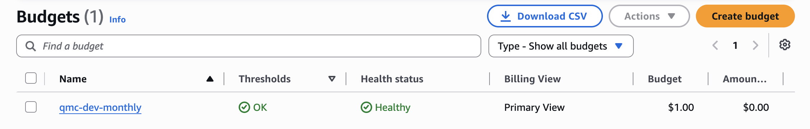

# Cost note

**Bottom line:** the design costs **$0**. At the reference load in the brief (100 jobs a day, each
1,000,000 paths) every AWS service used stays inside its *always-free* monthly allowance, and the same is
true, with far more room, for the few days the endpoint stays up for grading.

## Terms

- **Always-free allowance:** a monthly amount of a service that AWS never charges for, on any account,
  with no end date (for example 1,000,000 Lambda requests a month).
- **Free plan:** the kind of AWS account used here. It comes with **$100 of credits** (valid until
  22 April 2027) that would pay for usage beyond the always-free allowances. The design aims never to touch
  them.
- **GB-second:** the unit Lambda compute is counted in: memory in GB times run time in seconds. The worker
  has 1769 MB (1.728 GB), so one second of worker time is 1.728 GB-seconds.
- **Billed time:** the run time AWS charges for, rounded up to the next millisecond.
- **Provisioned capacity (DynamoDB):** a fixed number of read and write units per second, set in
  Terraform. The first 25 read and 25 write units are always free whatever the traffic.
- **Long polling (SQS):** how Lambda checks the queue for new shard messages. It keeps asking even when the
  queue is empty, and each ask counts as one SQS request.
- **Budget:** an AWS Budgets rule that emails when spending passes a threshold.

## Inputs: measured, not estimated

From the benchmarks on 22 October 2026 (`docs/evidence/m3-2026-10-22/`):

| Quantity | Measured value |
|----------|----------------|
| Worker compute per 1M-path job (10 shards, including the occasional retry) | 2.17 GB-seconds |
| Worker calls per job | 11 on average (10 shards + 1 retry; see the shard write conflict note in the benchmark report) |
| api compute per submit | 0.073 GB-seconds (512 MB function, about 140 ms, mostly waiting for Qrypt) |
| api compute per status check | about 0.005 GB-seconds |
| Idle SQS polling | about 850 empty receive requests an hour (about 20,400 a day), read from the queue's `NumberOfEmptyReceives` metric on 22 October |

## Reference load: 100 jobs a day for a month (3,000 jobs)

Each job: 1 submit, 10 shard messages, about 10 status checks.

| Service and allowance (per month) | Use per job | Use per month | Share of the allowance |
|-----------------------------------|-------------|---------------|------------------------|
| Lambda requests (1,000,000) | 1 submit + 11 worker calls + 10 status checks = 22 | 66,000 | 6.6% |
| Lambda compute (400,000 GB-seconds) | 2.17 worker + 0.073 submit + 10 × 0.005 checks ≈ 2.3 | about 6,900 | 1.7% |
| SQS requests (1,000,000) | 1 batch send + about 11 receives + 11 deletes ≈ 23 | 69,000 + idle polling of about 612,000 (measured rate) to 648,000 (worst case in the design) | 68% to 72% |
| DynamoDB capacity (25 read units, 25 write units) | | fixed at 15 read and 15 write units (table 10, index 5) whatever the traffic | 60% |
| DynamoDB storage (25 GB) | about 5 KB (job record + 10 shard results) | about 15 MB | under 0.1% |
| CloudWatch custom metrics (10) | | 6 | 60% |
| CloudWatch alarms (10) | | 4 | 40% |
| CloudWatch dashboards (3) | | 1 | 33% |
| CloudWatch Logs (5 GB) | about 60 log lines, roughly 20 KB | about 60 MB (kept 14 days) | about 1% |
| SNS (1,000 emails, 1,000,000 publishes) | alarm emails only | a handful | under 1% |
| SSM standard parameters, Function URL, AWS Budgets | no charge | | |
| Qrypt (not AWS) | 1 KiB | 3,000 KiB | over the 10 MB *project* cap in about 3 months, so this load is not run for real |

Result: **$0 a month** at the reference load. The largest share is idle SQS polling, which happens
whether or not jobs run; it still leaves about 28% of the free SQS requests unused.

## The grading window: 22 to 26 October 2026

The stack was created at 4:44 PM CT on Thursday 22 October 2026 and stays up until the end of
**Monday 26 October 2026 (CT)**; then `terraform destroy` removes it. That is under 5 days.

| Item | Up to 5 days |
|------|--------------|
| Idle SQS polling | 5 × 20,400 ≈ 102,000 requests (108,000 at the design's worst case) of 1,000,000 |
| Jobs for tests, benchmarks, demo and grading (assume at most 300, about 65 run so far) | about 6,600 Lambda requests, 700 GB-seconds, 7,000 SQS requests |
| DynamoDB, CloudWatch, SNS | the same fixed amounts as above, all free |

Everything stays far inside the monthly allowances (October and November each have their own), so the
expected cost is **$0** and the $100 of credits stay unused.

## Budget

Terraform creates the budget `qmc-dev-monthly`: a **$1.00 a month** cost budget for the whole account,
emailing at 50% and 100% of actual spend and at 100% of forecast spend.

Actual spend reported by AWS Budgets at 5:25 PM CT on 22 October 2026: **$0.00**. (AWS updates budget
figures up to about three times a day, so a charge can take several hours to show up.)

### Budget console screenshot

The `qmc-dev-monthly` budget in the AWS Billing console (AWS Budgets page), captured on 22 October 2026:
limit $1.00, amount used $0.00, thresholds OK, health status Healthy.

## After grading

`terraform destroy` removes every resource, which also stops the idle SQS polling. The two SSM parameters
were created outside Terraform and are deleted with
`aws ssm delete-parameters --profile qmc --names /qmc/dev/qrypt_api_key /qmc/dev/api_key`.
