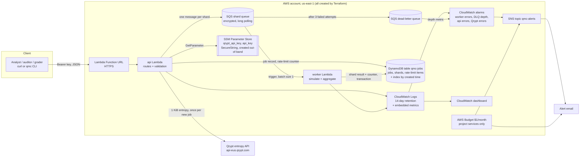

# Design: Quantum-Seeded Monte Carlo Platform on AWS

Status: proposal for approval. Nothing is built or deployed yet. Requirement IDs (FR-, EC-, NFR-, SEC-,
CQ-, D-) refer to `docs/PRD.md`. Terms are defined in the PRD glossary and in `docs/research.md`.

## 1. Summary of the main decisions
| Decision | Choice | Why (short) |
|----------|--------|-------------|
| Region | `us-east-1` | Already the default; closest to Qrypt's US East endpoint; Budgets live there |
| Function language | Python 3.13, **standard library only** (no NumPy) | Fast enough (about 1 s of compute per 1M paths); tiny packages and quick cold starts; Python's `random()` promises the same numbers for the same seed across versions, NumPy's `Generator` does not |
| Shard seeds | HKDF-SHA256 (a standard key-derivation function) from the master seed and shard index | Standard library only, official test vectors, deterministic |
| Random generator per shard | Python's `random.Random` (Mersenne Twister) seeded with the 256-bit shard seed; normal numbers by our own Box-Muller step on `random()` | Stable across Python versions; we control every step that affects the numbers |
| API | One "api" Lambda behind one Function URL, routing five endpoints | No API Gateway (not always-free); one URL for graders |
| API auth | Bearer key checked against an SSM SecureString (default), `AWS_IAM` as a Terraform switch | Graders can call the deployed URL with plain `curl`; IAM option for graders deploying in their own account |
| Fan-out | One SQS queue, one message per shard, worker Lambda with batch size 1; DLQ after 3 failed attempts | Simple, cheap, retry and dead-letter built in |
| Completion | Each worker writes its shard result and bumps the job's counter in one DynamoDB transaction; the worker that finishes the last shard combines the results | Idempotent under duplicate delivery; no extra orchestrator (Step Functions would not stay free at the reference load) |
| Database | One DynamoDB table (provisioned 10 read / 10 write units) plus one index (5/5) | 15 of the 25 free units; on-demand is not free |
| Metrics | CloudWatch Embedded Metric Format (metrics written as structured log lines), one fixed dimension | No metric API calls; 6 custom metrics out of 10 free |
| Budget | $1/month, filtered to this project's services, alert to SNS and email | Route 53 already costs about $1/month in this account, so an account-wide $1 budget would alert every month |
| Secrets | Qrypt token and API key created in SSM out-of-band with a helper script; Terraform only knows their *names* | Values never enter Terraform state or the repo |

## 2. Architecture



### Endpoints (all on the one Function URL; all require the bearer key)
| Method and path | What it does | Main responses |
|-----------------|-------------|----------------|
| `POST /jobs` | Validate, check rate limit, fetch 1 KiB from Qrypt, store job, enqueue shards | 202 with `job_id` and status `QUEUED`; 400 invalid input; 429 our rate limit; 502/503 Qrypt problem (cause named) |
| `GET /jobs` | List recent jobs, newest first, paginated | 200 with `jobs: []` on a fresh deployment |
| `GET /jobs/{id}` | Status, progress (`completed/shards`), result, Black-Scholes reference, replay check | 200; 404 with message for unknown id |
| `POST /jobs/{id}/replay` | New job from the stored seed and parameters; no Qrypt call | 202 with the new `job_id`; 404 unknown; 409 if the original is not `COMPLETE` |
| `GET /health` | Checks DynamoDB (describe table) and SSM (read parameter metadata) | 200 with each check, or 503 naming the failing one |

## 3. Terraform layout (CQ-2)
```
infra/
  versions.tf        Terraform >= 1.9, AWS and archive providers pinned in .terraform.lock.hcl
  main.tf            root module: provider (default tags project=qrypt-monte-carlo, env), wires modules
  variables.tf       documented inputs (below)       outputs.tf  function URL, table, queue names
  modules/
    data/            DynamoDB table, index, TTL (time-to-live) for rate-limit items, encryption
    workers/         shard queue + DLQ + redrive, worker Lambda, role, log group, SQS trigger
    api/             api Lambda, role, Function URL + both invoke permissions, log group
    observability/   SNS topic + email subscription, alarms, dashboard
    budget/          AWS Budget, SNS topic policy allowing Budgets to publish
src/qmc/             pure Python: validate, seeds, simulate, aggregate, black_scholes, entropy (Qrypt + mock), ratelimit logic
src/handlers/        api.py, worker.py (thin: parse, call qmc, talk to AWS)
scripts/             put-secrets.sh, qmc.py (small CLI), bench_submit.py, bench_job.py, force_failure.sh, rebuild_timer.sh
tests/               pytest unit tests + handler tests against moto (a library that fakes AWS locally)
```
Main variables: `environment`, `alert_email`, `api_auth_type` (`BEARER` or `AWS_IAM`),
`qrypt_param_name`, `api_key_param_name`, `max_paths` (10,000,000), `max_shards` (20),
`max_paths_per_shard` (500,000), `worker_reserved_concurrency` (20), `api_reserved_concurrency` (5),
`worker_timeout_s` (60), `max_receive_count` (3), `log_retention_days` (14), `budget_limit_usd` (1),
`enable_fault_injection` (false). Lambda code is zipped by Terraform's `archive_file`, which gives the same
hash for the same files, so an unchanged repo shows no drift. Local state, git-ignored.

## 4. Data model (one DynamoDB table `qmc-<env>-jobs`)
| Item | Key (PK / SK) | Main attributes |
|------|---------------|-----------------|
| Job | `JOB#<id>` / `META` | `status` (QUEUED, RUNNING, COMPLETE, PARTIAL), `params` {S0, K, r, sigma, T, paths, shards}, `master_seed_hex` (64 hex chars), `seed_source` {provider "qrypt", KiB 1, SHA-256 of the full 1,024-byte block, fetched_at} or {replay_of}, `algo_version` "qmc-v1", `runtime` "python3.13", `completed`, `failed`, `failed_shards`, `created_at`, `finished_at`, `result` {estimate, std_error, ci95_low, ci95_high, n, estimate_hex}, `black_scholes`, `replay_check` {original_estimate_hex, bit_identical}, `cost` {gb_seconds, requests}, index keys `gsi1pk`="JOBS", `gsi1sk`=created_at#id |
| Shard | `JOB#<id>` / `SHARD#0007` | `state` (DONE or FAILED), `sum`, `sum_sq`, `n`, `duration_ms`, `attempts`, `error` (FAILED only) |
| Rate window | `RATE#<10-second window number>` / `RATE` | `count`, `ttl` (auto-deleted after about a minute) |

Index `by_created` (`gsi1pk`, `gsi1sk`) serves `GET /jobs` newest first. Capacity: table 10/10, index 5/5.
Job ids are random UUIDs (unique ids), not seeds, so ids reveal nothing.

## 5. Seed flow and simulation (FR-1, FR-2, FR-5)
1. `POST /jobs` gets one 1 KiB block from Qrypt. **Master seed = the first 32 bytes (256 bits)** of the
   block; the SHA-256 fingerprint of the whole block is stored for provenance.
2. Shard `i` of `n` gets `seed_i = HKDF-SHA256(key = master seed, salt = "qmc-v1", info = "shard" + i +
   n as 4-byte numbers, length = 32 bytes)`. No clock, no shared generator.
3. The worker builds `random.Random(int(seed_i))`, draws uniform numbers with `random()`, turns pairs into
   normal numbers with a fixed Box-Muller formula, and simulates
   `S_T = S0 · exp((r − sigma²/2)·T + sigma·√T·Z)`, payoff `max(S_T − K, 0)`.
   Paths per shard: `paths // shards`, with the first `paths % shards` shards taking one extra path.
4. Each shard stores `sum`, `sum_sq`, `n` of the undiscounted payoffs.
5. Aggregation adds shard totals **in shard-index order with exact summation** (`math.fsum`), then:
   estimate = e^(−rT) · sum / n; standard error = e^(−rT) · √((sum_sq − sum²/n) / (n − 1)) / √n;
   95% interval = estimate ± 1.96 × standard error. The Black-Scholes price is stored beside it.
6. **Replay** copies the master seed, parameters, shard count and `algo_version` into a new job (no Qrypt
   call, 0 KiB). When it completes, `replay_check` compares the two estimates as exact binary values
   (`float.hex`) and records `bit_identical: true/false`.

Same seed + same parameters + same code version + same runtime + same summation order = the same bits.
If the code version ever changes, `algo_version` changes too, and a replay uses the stored version's code
path (only v1 exists for now).

## 6. Error and edge-case handling
| Case | Handling |
|------|----------|
| EC-1 Qrypt fails | One attempt with a 3-second timeout; no retry inside the request (keeps latency bounded). Map: 401 → "Qrypt rejected the request (missing or malformed auth)"; 403 → "Qrypt token rejected or entropy quota reached"; 429 → "Qrypt rate limit"; 500/503/timeout/network → "Qrypt unavailable". Return 502 (401/403) or 503 (others) with `error` and `cause`; **no job is written and no fallback seed exists in the code**. A test asserts that no code path seeds from time or `os.urandom`. Count `QryptErrors` metric. |
| EC-2 Duplicate delivery | Transaction: put shard item only if it does not exist + add 1 to `completed`. A repeat fails the condition; the worker treats that as success and the message is deleted. Paths can never be counted twice. |
| EC-3 Worker failure | On an exception the worker shortens the message's hidden time (2 s, then 4 s backoff) so retries are quick, then re-raises. On the last attempt (`ApproximateReceiveCount` = 3) it first records the shard as FAILED and bumps `failed`. SQS moves the message to the DLQ; the DLQ alarm fires. When `completed + failed = shards` and `failed > 0` the job becomes `PARTIAL` with `failed_shards`; it is never `COMPLETE`. If a worker dies without recording (crash, timeout), `GET /jobs/{id}` marks a job older than 10 minutes with missing shards as `PARTIAL` and lists them. |
| EC-4 Timeout | `paths/shards` capped at 500,000 paths per shard (about 1 s on Lambda) against a 60-second timeout; larger ratios rejected with 400. |
| EC-5 Qrypt burst | A DynamoDB counter per 10-second window allows at most 25 Qrypt calls per window (margin under 30); above it, 429 with `Retry-After`. The api function's reserved concurrency (5) also caps parallel calls. |
| EC-6 Cost runaway | `max_paths` 10,000,000 and `max_shards` 20 per job; worker reserved concurrency 20; api reserved concurrency 5. Over-limit requests rejected with 400. |
| EC-7 Invalid input | Strict validation: all seven fields required, numeric (booleans and strings rejected), finite; `S0`, `K`, `sigma`, `T` > 0; `paths`, `shards` whole numbers ≥ 1; `shards ≤ paths`; limits above; unknown fields rejected; body ≤ 4 KB. 400 with a message naming the field. |
| EC-8 Teardown, drift | Log groups are created by Terraform (so destroy removes them); deletion protection off; deterministic zips; both Function URL permissions in Terraform. Checked with `terraform plan -detailed-exitcode` after apply and an AWS resource-tag search after destroy. |
| EC-9 First run | `GET /jobs` queries the index and returns `[]`; unknown id → 404 `{"error": "job not found", "job_id": ...}`. |
| CQ-4 | Each handler has a top-level guard: unexpected errors become 500 `{"error": "internal error", "request_id": ...}` with the details logged, never the token. |

**Fault injection for the demo (FR-6 acceptance):** with `enable_fault_injection = true`, a job may include
`"fail_shards": [3]`; the worker raises for that shard, it retries twice, lands in the DLQ, the alarm emails
within a few minutes and the job shows `PARTIAL`. With the switch off (default), the field is rejected.

## 7. Measurement method for each benchmark
| Benchmark | How we measure | What we report |
|-----------|----------------|----------------|
| NFR-1 submit latency < 800 ms p95 warm | `scripts/bench_submit.py`: 1 warm-up call, then 50 `POST /jobs` (10,000 paths, 1 shard, to keep compute tiny), paced at 2 per second to respect the Qrypt limit. Client-side timing from the lab plus the server-side time logged by the function | p50 and p95 for both, network distance noted. Uses 51 KiB of entropy |
| NFR-2 1M paths < 60 s | `scripts/bench_job.py`: 5 jobs of 1,000,000 paths × 10 shards; time from sending `POST /jobs` to first `COMPLETE` seen while polling every 0.5 s | each run, median, worst; also the error versus Black-Scholes in standard errors |
| NFR-3 $0 at 100 jobs/day | Arithmetic in section 10, using *measured* durations from the NFR-2 runs (Lambda billed duration in the logs) | the table, with headroom per allowance |
| NFR-4 rebuild < 10 min | `scripts/rebuild_timer.sh`: `terraform destroy`, then time `terraform apply` from empty | apply time; then `terraform plan` shows no changes |

Each benchmark is run once with this method and reported as measured. If one misses, we report it and the
likely cause rather than tuning in a loop.

## 8. Security plan (SEC-1 to SEC-6)
- **Secrets out of state:** `scripts/put-secrets.sh` reads `QRYPT_API_KEY` and `API_KEY` from the local
  `.env` and writes SSM SecureStrings through a temporary file readable only by the user (so the value
  never appears on a command line or in shell history), then deletes the file. Terraform builds the
  parameter ARN (its AWS address) from the *name*; it never uses the `aws_ssm_parameter` data source,
  which would copy the value into state. Why: Terraform state is plain JSON, and anything Terraform reads
  or sets is written there.
- **Least privilege, one role per function, no `*`:**
  - api: `dynamodb:GetItem/PutItem/UpdateItem/Query/DescribeTable` on the table and its index;
    `sqs:SendMessage` on the shard queue; `ssm:GetParameter` on the two parameter ARNs; write to its own
    log group.
  - worker: `dynamodb:GetItem/UpdateItem/Query/PutItem/ConditionCheckItem` on the table;
    `sqs:ReceiveMessage/DeleteMessage/GetQueueAttributes/ChangeMessageVisibility` on the shard queue;
    write to its own log group. No access to SSM or Qrypt.
  - The default AWS-managed `aws/ssm` key decrypts SecureStrings through SSM for allowed callers, so no
    KMS permission is added (verified during the build).
- **Auth:** constant-time comparison of the bearer key; key cached in memory for 5 minutes per function
  copy; 401 without detail on failure. Function URL auth `NONE` plus our check, or `AWS_IAM` by switch.
- **Encryption:** DynamoDB encryption at rest (AWS-owned key, the default); SQS server-side encryption
  with SQS-managed keys on both queues; Function URL is HTTPS only; Qrypt over HTTPS.
- **Logs:** JSON lines with `job_id`, `shard`, `request_id`; headers and secrets are never logged; the
  Qrypt client sends its own User-Agent (Qrypt's edge blocks the default Python one). 14-day retention.
- **SNS topic** is not encrypted with a customer key: CloudWatch alarms and Budgets cannot publish to a
  topic encrypted with the default `aws/sns` key, and a customer key costs $1/month. Alert messages hold
  no secrets. This is a documented, justified scanner suppression.

## 9. Test plan (CQ-1, CQ-7, D-3)
- **Unit (pure code, no AWS, no token):**
  - seeds: RFC 5869 HKDF test vectors; 1,000 shard seeds distinct; same master gives the same seeds;
    different masters differ;
  - simulation: S0=100, K=100, r=0.05, sigma=0.2, T=1, **1,000,000 paths**: estimate within 3 standard
    errors of Black-Scholes 10.4506 (about 2 seconds locally); fixed-seed "golden" values so any change in
    the numbers is caught;
  - aggregation: matches a single-pass calculation; empty and single-path edge cases; fixed order;
  - replay: run the same job twice through the in-process pipeline, compare `float.hex` of the estimate;
  - idempotency: deliver every shard message twice (and out of order); totals unchanged;
  - validation: every invalid input in EC-7 gets 400 and names the field;
  - Black-Scholes formula against published values.
- **Mock Qrypt client:** an `EntropySource` interface with `QryptEntropySource` (real) and
  `MockEntropySource` (fixed bytes, or a chosen error: 401, 403, 429, 500, 503, timeout, bad JSON). Tests
  check each error maps to the right message and that no job is written.
- **Handlers:** api and worker against moto's fake DynamoDB, SQS and SSM: routes, auth, 404, empty list,
  rate limit, `PARTIAL`, last-attempt handling.
- **Coverage:** `pytest --cov=src --cov-fail-under=80` in CI (aim higher on the pure modules).
- **Live checks (after deploy, by script, not in CI):** end-to-end job, replay, forced failure, the four
  benchmarks.

## 10. CI on GitLab (CQ-5, ST-4)
`.gitlab-ci.yml`, every push, no AWS credentials in CI:
1. `lint`: `ruff check` and `ruff format --check` (Python linter and formatter), Python 3.13 image.
2. `test`: `pytest` with coverage gate 80%.
3. `terraform`: `terraform fmt -check -recursive`, `terraform init -backend=false`, `terraform validate`.
4. `tflint`: `tflint --init` (AWS rules plugin) then `tflint --recursive`.
5. `checkov` (stretch ST-4): scan `infra/` with each suppression commented with its reason.

## 11. Cost arithmetic (NFR-3), reference load
100 jobs a day × 30 days = **3,000 jobs a month**, each 1,000,000 paths in 10 shards. Durations are
estimates until the benchmarks replace them with measurements.

| Allowance (monthly) | Usage per job | Monthly use | Share of free |
|---------------------|---------------|-------------|---------------|
| Lambda requests (1,000,000) | 1 submit + 10 shards + ~10 status checks = 21 | 63,000 | 6% |
| Lambda compute (400,000 GB-s) | workers: ~2 s total × 1.769 GB ≈ 3.5 GB-s; api: ~11 calls × 0.3 s × 0.5 GB ≈ 1.7 GB-s | ~15,600 GB-s | 4% (still under 20% if 5× slower) |
| SQS requests (1,000,000) | 1 batch send + up to 10 receives + 10 deletes = 21 | 63,000 + **up to 648,000 idle polling** | up to 71% (largest risk; still free) |
| DynamoDB (25 RCU / 25 WCU, 25 GB) | Provisioned 15/15 is free regardless of traffic; ~5 KB stored per job | 15 MB | 60% of capacity units; ~0% storage |
| CloudWatch | 6 custom metrics; 4 new alarms + 1 existing; ~130 MB logs; 1 dashboard | | 60% metrics, 50% alarms, 3% logs |
| SNS | a few alarm publishes and emails | < 100 | ~0% |
| SSM standard parameters, Function URLs, Budget alerts | no charge | | |
| KMS (20,000 free requests) | decrypt on a function cold start, then cached | < 2,000 | < 10% |

Result: **$0** at the reference load. Qrypt at that load would use 3,000 KiB a month, so we will not run it
for real; actual project entropy use is about 150 KiB in total (tests, benchmarks, demo), against the
10,240 KiB budget. Idle cost with nothing running is $0 apart from the free SQS polling. After grading,
`terraform destroy` removes everything.

## 12. Stretch goals
| Stretch | Plan | Reason |
|---------|------|--------|
| ST-2 CloudWatch dashboard | **Do** | Cheap (1 of 3 free), makes the demo clearer |
| ST-4 Checkov in CI | **Do** | Checkov is already installed; a few lines of CI |
| ST-7 Per-job cost | **Do** | Workers already record their duration; multiply by memory, show in the result |
| ST-3 `PENDING_ENTROPY` | **If time allows**, using delayed messages on the *same* queue | A second queue with its own trigger would add up to 648,000 idle requests and break the free SQS allowance |
| ST-1 Step Functions | Skip | Free allowance is 4,000 transitions a month; the reference load needs about 45,000, so it would not be $0 |
| ST-5 Value-at-Risk | Skip | New workload outside the core rubric; time better spent on reliability |
| ST-6 Ephemeral environments | Skip | Needs AWS credentials stored in CI, and the brief's version is GitHub Actions while we use GitLab |

A small `qmc` command-line client (`submit`, `status`, `wait`, `replay`) is planned to make the platform feel
like a product in the demo and the grader quick-start.

## 13. Trade-offs
| Choice | Alternative | Why we chose it |
|--------|------------|-----------------|
| Plain Python random numbers | NumPy | NumPy is faster, but plain Python is fast enough here, avoids a 25 to 35 MB layer and slower cold starts, and has a firmer same-numbers-across-versions promise. Cost: about 2× more compute, still ~4% of the free allowance |
| HKDF shard seeds | `SeedSequence.spawn` | Same guarantees without NumPy; standard test vectors |
| First 32 bytes of the Qrypt block as the master seed | Hash of the whole block | Simplest to explain and audit: the stored seed is literally Qrypt's bytes. The block's fingerprint is kept for provenance |
| Worker that finishes last does the combining | Step Functions, or a separate aggregator | No extra service or cost; the transaction counter makes it safe; the combining is deterministic so a rare double run writes the same result |
| Batch size 1 on the queue | Batches of 10 | One shard = one invocation keeps retries and DLQ handling per shard and simple. Requests stay well within free |
| Reserved concurrency 20 = max shards | Lower concurrency | A job never gets throttled, so throttling cannot push healthy shards toward the DLQ |
| Short retry backoff set by the worker | Long default hidden time (6× timeout) | Keeps the 6× safety while running, but lets failures retry in seconds, so the DLQ demo takes minutes, not half an hour |
| Bearer key by default | `AWS_IAM` only | Graders can test our deployed URL with `curl`; IAM remains a switch |
| Single table | Separate tables | Fewer resources, one capacity budget (15 of 25 units), one transaction scope |
| Provisioned capacity | On-demand | On-demand requests are not in the free tier |
| Embedded metrics in logs | `PutMetricData` calls | No extra API calls or latency in the request path |
| Reject when Qrypt fails | Local fallback seed | Required by the brief; a silent fallback would break the audit story |
| No retry of Qrypt inside `POST /jobs` | Retry with backoff | Keeps p95 latency bounded; `PENDING_ENTROPY` is the planned retry path |
| Local Terraform state | Remote state in S3 | Allowed by the brief; S3 is not always-free; one operator |

## 14. Open questions for approval
1. Alert email address for budget and alarm emails (AWS sends a confirmation link that must be clicked).
2. Region `us-east-1`: OK?
3. Bearer key by default with `AWS_IAM` as a switch: OK? The deployed URL's key would be shared with
   graders in the submission notes, not in the repo.
4. Budget filtered to this project's services (because of the existing Route 53 cost): OK?
5. Due date, and how long the endpoint must stay up for grading.
6. GitLab only, or also a GitHub mirror (the brief says GitHub)?
7. Stretch picks above, and the `qmc` CLI: OK?
