# oh-my-mermaid architecture views

Generated by [oh-my-mermaid](https://github.com/oh-my-mermaid/oh-my-mermaid) 0.2.0 (the `omm-scan` skill, run with Claude Code) from `src/` and `infra/`. The sources are in `.omm/` (one folder per view; each has `diagram.mmd` plus description, context, constraint, concern, todo and note fields). To browse them interactively: `npm install -g oh-my-mermaid`, then `omm view` in the repository folder (opens http://localhost:3000). The PNGs below were rendered with mermaid-cli. These views are machine-generated and have not been edited; check them against the Terraform before relying on them.

## overall-architecture

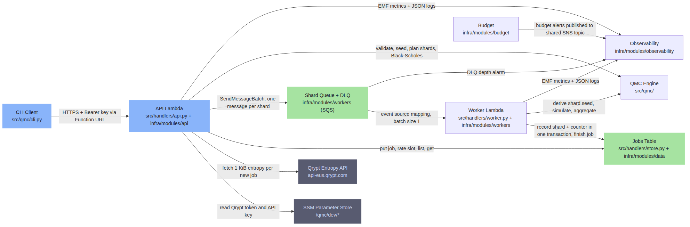

## overall-architecture / api-function

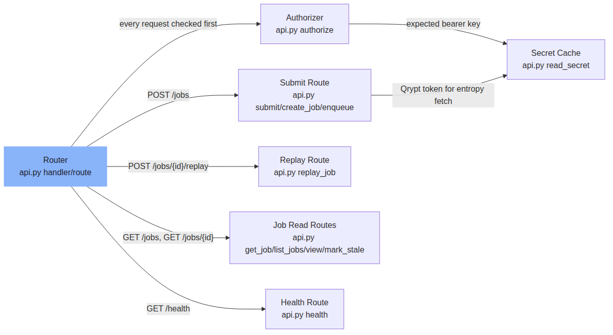

## overall-architecture / worker-function

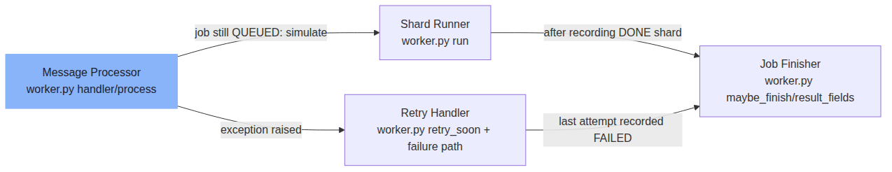

## overall-architecture / jobs-table

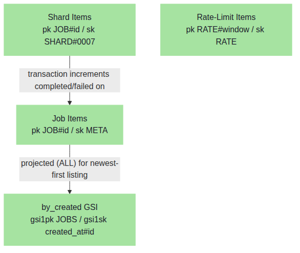

## overall-architecture / qmc-engine

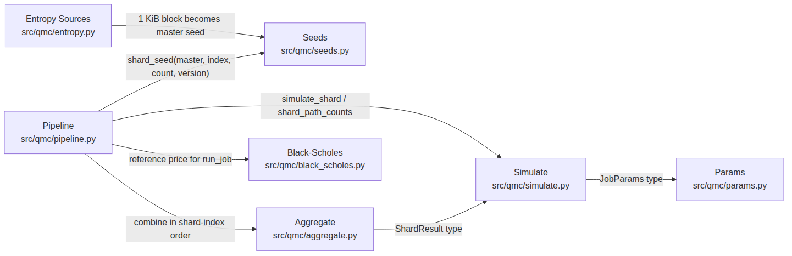

## overall-architecture / observability

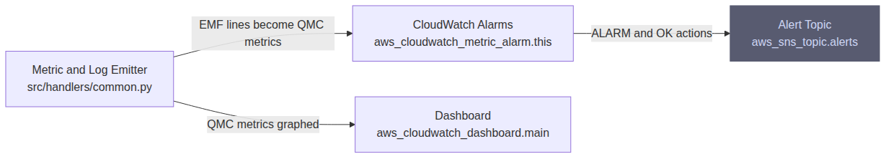

## request-lifecycle

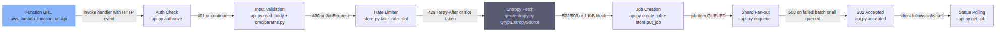

## data-flow

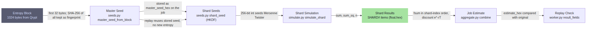

## state-transitions

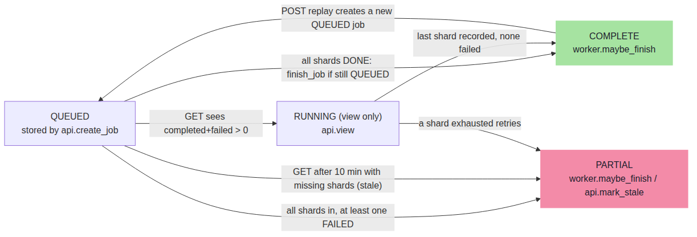

## orchestration

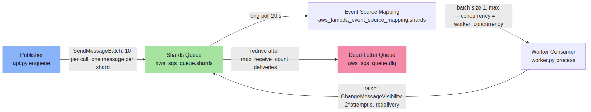

## external-integrations

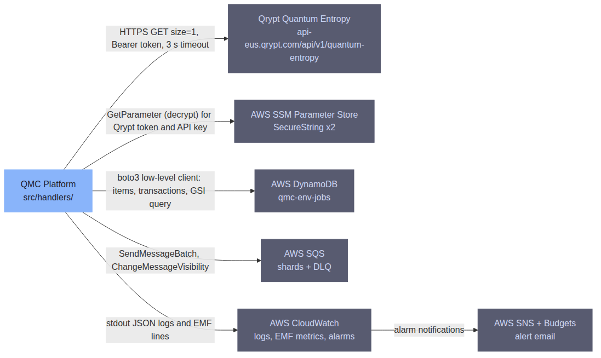

## command-surface

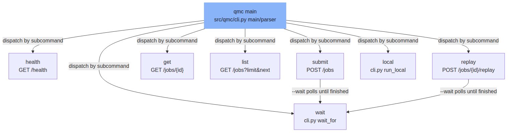

